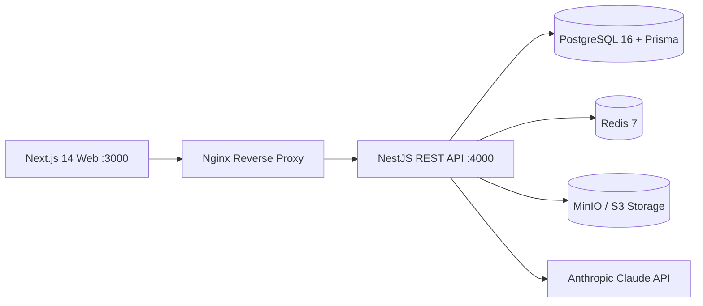

# KasbYo‘l AI — Ta’lim va Kasb Yo‘naltirish Platformasi

Maktab o‘quvchilari (8–11-sinf), o‘qituvchilar va maktab adminlari uchun mo‘ljallangan full-stack ta’lim va kasb yo‘naltirish platformasi.

## Arxitektura



## Lokal ishga tushirish (3 ta buyruq)

```bash
cp .env.example .env
docker compose up -d postgres redis minio mailhog
pnpm install && pnpm db:migrate && pnpm db:seed && pnpm dev
```

## Demo hisoblar (parol: `KasbYol2026!`)

| Rol | Email | Imkoniyatlar |
|---|---|---|
| `SUPER_ADMIN` | `superadmin@kasbyol.uz` | Barcha maktablar, adminlar va audit jurnali |
| `ADMIN` | `admin@kasbyol.uz` | Maktab kurslari, sinflari, o‘quvchilari va CSV eksport |
| `TEACHER` | `teacher1@kasbyol.uz` | Kurslar, darslar, topshiriqlar va baholash |
| `STUDENT` | `student1@kasbyol.uz` | Kurslar, 42 savolli RIASEC test, 30 kasb va AI Murabbiy |

## API Hujjatlari va Xavfsizlik
- Swagger OpenAPI: `http://localhost:4000/api/docs`
- Har bir endpoint RBAC va maktab chegarasi (`tenant isolation`) bilan himoyalangan.
- Barcha ma’lumot ko‘rish va eksport amallari `AuditLog` jadvaliga yoziladi.
